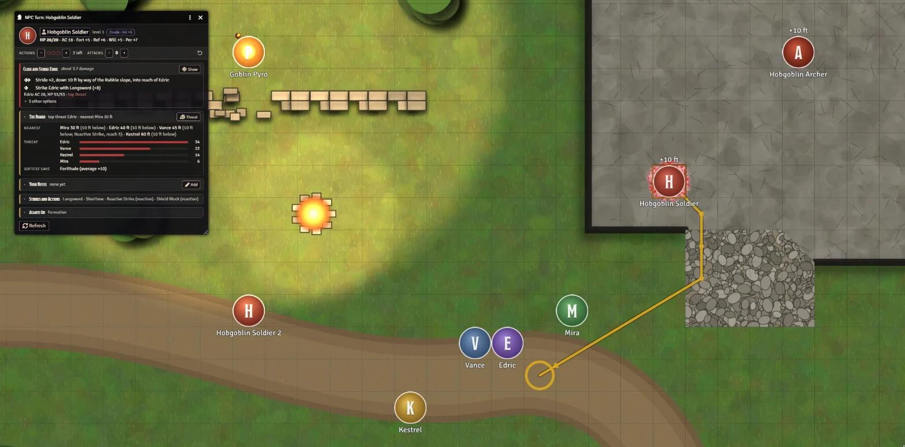
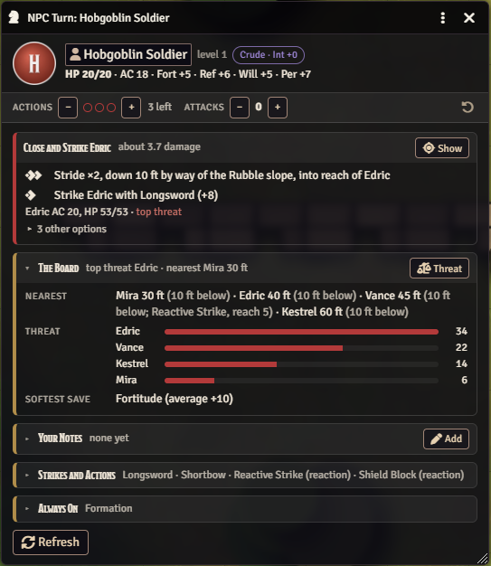
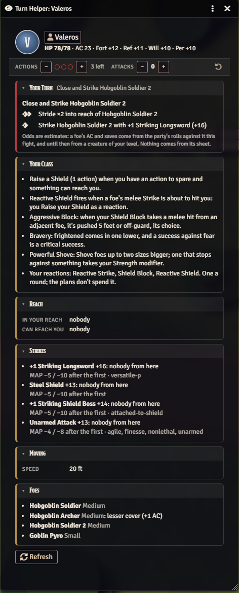
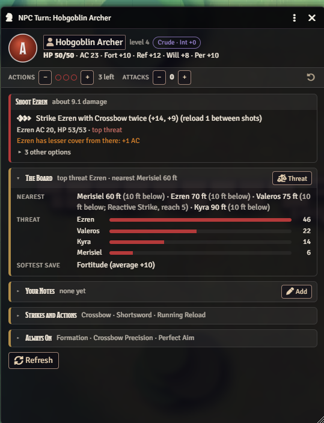
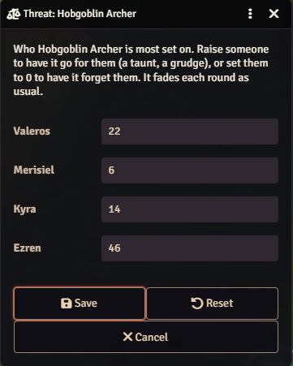

# PF2e Tactics

PF2e Tactics (formerly PF2e NPC Tactics): an NPC turn card for the GM, and a Turn Helper for players. When an NPC's turn starts it shows a recommended turn worked out from the creature's abilities and the board (who it can reach, flanking, reactions it would provoke, expected damage, who it would pick given its wits and who has hurt it), a few alternatives, the encounter's own tactics, triggers to watch for, and every Strike, action, reaction and spell it has. Nothing is moved or rolled for you. The Turn Helper (a macro, or a per-player setting to open it on their turn) gives a player a recommended turn for their own character, with their class read in (Commander tactics, Spellstrike, Exploit Vulnerability...), on what the party can judge of each foe: reach, Strikes and targets, flanking, cover, what moving would provoke, and what the party's own rolls have learned. Nothing from an NPC's sheet.

## What it looks like



It's the hobgoblin's turn on the ledge. The card suggests two Strides down the rubble slope to reach Merisiel, then a Strike, and **Show** draws that path on the map so you can check it at a glance. The Board says who is nearest (and who is 10 feet below), who could hit it with a Reactive Strike, and which save the party is weakest in.

<table>
<tr>
<td width="50%" valign="top"></td>
<td width="50%" valign="top"></td>
</tr>
<tr>
<td valign="top"><b>NPC turn card.</b> A suggested turn with a damage estimate, a few other options, the board, your own notes for the creature, and every Strike and action it has. Nothing is moved or rolled for you.</td>
<td valign="top"><b>Turn Helper</b> for players. A suggested turn for their own character, the class notes that bear on it, who can reach them and who they could flank, and what the party can see and has learned about each foe. Nothing comes from an NPC's sheet.</td>
</tr>
</table>

Threat works like aggro. Each creature remembers who has been a problem for it (damage, spells and saves, healing its foes), and when two targets are close it goes for the one who has proven dangerous. Here the archer shoots Ezren, its top threat, though Merisiel is nearer. More in [Threat](#threat).

<table>
<tr>
<td width="60%" valign="top"></td>
<td width="40%" valign="top"></td>
</tr>
<tr>
<td valign="top"><b>The Board</b> shows the creature's threat table as bars. It fades each round, and drops when someone falls unconscious.</td>
<td valign="top"><b>Threat</b> sets it by hand: raise someone for a taunt or a grudge, set someone to 0 to have it forget them, or Reset.</td>
</tr>
</table>

## Install

In Foundry, go to **Add-on Modules**, then **Install Module**, and paste this into **Manifest URL**:

```
https://github.com/Sir-Bayard/pf2e-tactics/releases/latest/download/module.json
```

Foundry's **Update** button then picks up each new release. You can also download `module.zip` from the [latest release](https://github.com/Sir-Bayard/pf2e-tactics/releases/latest) and unzip it into `Data/modules/pf2e-tactics`.

Requires Foundry VTT 14 (verified on 14.369) and the Pathfinder 2e system 8.0.0 or later.

### Coming from pf2e-npc-tactics (2.1 or earlier)

Turn the old module off (or delete its folder) and turn this one on. The first GM load copies the old module's settings over, and each player's client copies their own on first load. Notes, recharge timers and threat written under the old id are still read; new ones are written under pf2e-tactics. Other modules that look for "pf2e-npc-tactics" find the same API there while the old folder is still installed.

## What it does

When an NPC's turn starts, a window shows the GM how that creature can fight well right now:

- A recommended turn, worked out from its abilities and the board: who it can reach and with how many actions, flanking with its allies, which player reactions (Reactive Strike and the like) a move would provoke, and the expected damage of each option against each target's AC and saves.
- Two or three alternatives, so you can pick something else in a second.
- Show draws the recommended path on your map, around any reactions it avoids. Only you see it: it's drawn in your client, not saved to the scene. Click Show again to hide it; it also clears on the next turn.
- Triggers to watch for (below), and the encounter's own tactics.
- Every Strike, action, reaction, free action, aura and spell it has, so nothing gets forgotten.
- **The turn so far**: actions used and attacks made, so the advice after a Stride or a Strike is for the actions it has left, at the right multiple attack penalty (below).

## The card

Laid out like the other table tools (Campaign Trackers, Campaign Ledger, NPC Attitudes): the creature across the top (with how it thinks, say "Instinct · Int -4"; hover for what that means), the turn count under it, then cards. A red edge is what to do now (the recommended turn, a trigger that just came true), gold is reference: The Board, Tactics, Your Notes, Strikes and Actions, Always On, spells. Click a card's title to fold it; each one stays open or shut the way you left it (kept in your browser). Folded, a card still shows a one-line summary. Chat whispers use the same layout.

Nothing is moved, attacked or cast for you. The GM decides. The one die it rolls is a recharge ("can't use again for 1d4 rounds"), whispered to the GMs, so the card knows when the ability is back. It is rolled once, from the ability's own card. With PF2e Workbench's "Recharge reminder" on, Workbench rolls it instead (its "Used Poison Breath" effect), and the card reads that effect, so there is one roll and one timer. When a creature whose stat block says a critical hit recharges its breath (Draconic Momentum) scores one, the breath is ready again at once (Workbench's effect is removed too), and the GMs are told.

It began as the NPC turn card of a campaign module (0.9.x); notes and recharge timers from there carry over.

## Settings

- **NPC turn cards**: Window (default), Chat whisper, or Off.
- **Whisper triggers**: On by default: a whisper to the GMs the moment a trigger comes true, even on a player's turn.
- **Track threat**: On by default (see [Threat](#threat)). Off: targets come from the board alone.
- **How much threat counts**: Lightly, Normal (default) or Strongly: how much juicier the top threat looks (see [Threat](#threat)).
- **How fast threat fades**: Halves each round (default), loses a quarter each round, or never fades.
- **Threat lost when someone falls unconscious (%)**: 50 by default.

## Opening it by hand

Macro: `game.modules.get("pf2e-tactics").api.open()`

Shows the selected token, or whoever's turn it is.

## How it reads abilities

From PF2e's data first: action costs, traits, links to the basic actions (Step, Stride, Strike, Shove...), condition links, checks, damage and area templates in the description. From the wording second: "Strides twice", "Steps 5 feet twice", "moves up to 60 feet without triggering reactions", "makes two claw Strikes". So an ability like Elf Step replaces a plain Step wherever a turn needs one, and Sudden Charge replaces Stride-then-Strike. Follow-ups such as Knockdown, Strike variants such as Combat Grab, and self-buffs such as a frenzy are weighed as whole turns. Turn order follows each ability's own traits and wording: press (or "is suffering a multiple attack penalty") only after an attack, open (or "hasn't attempted a Strike this turn") only first, flourish once. An NPC ability can share a name with a Player Core feat and still work differently (the ruffian's Combat Grab has no press), so the stat block wins. Demoralize goes before the Strikes it helps. Pack Attack, Sneak Attack, flanking, volley, deadly and fatal are counted.

Abilities that need a grabbed or restrained creature (Captive Rake, Swallow Whole) are planned only on one, or after a Grab that could take hold. "A jaws Strike with each of its heads, each against a different target" (Double Bite) goes at different foes; "count as one attack", "the penalty increases only after both" and the like are read for the multiple attack penalty; "two claw Strikes and one horn Strike" is three Strikes. "All adjacent creatures" is a 5-foot emanation (Spore Cloud).

Each action on the card is tagged with what it does (movement, area, sets up, follow-up...).

## How it reads the board

Only the scene that's open, on a square grid. It finds paths around walls and enemies, counts difficult terrain from Regions (PF2e's environment feature or a movement cost), and uses PF2e's own reach and ally/enemy rules.

- **Closed doors**: it goes through them, and opening one costs an action (an Interact, which ends the Stride it was on). The step says so: "Stride, opening a door on the way, into reach of Valeros". Locked doors stay shut. A Step can't go through a door.
- PF2e Terrains and PF2e Toolbelt regions: uneven ground, inclines (easy with a climb Speed) and hazardous terrain cost extra, like difficult terrain, and a plan whose path crosses them says so ("The way crosses uneven ground (Balance DC 15; off-guard on a failure)"). Toolbelt's difficult terrain counts too.
- **Height**: a token's elevation counts, the way PF2e measures it (10 feet up beside a Medium creature is 10 feet away; a Large creature reaches 5 feet higher). Reach, range, Reactive Strike and areas all use it, and The Board says how far above or below each foe is. A flier rises or drops to a foe's height as part of its Fly. A token whose movement is set to Fly and is above its floor is up in the air: it has to Fly every turn or fall, so a turn that stays up spends an action on it ("Fly in place, to stay up"), and flying off says how high it must go to be out of reach. A walker on a ledge or bank has three ways down: walk round by a ramp, Climb an incline (PF2e Terrains; 5 feet an action, each an Athletics check unless it has a climb Speed), or drop (half the drop in damage, lands prone, Stands, which provokes like any move in reach). Anything that thinks, animals included, counts a drop as an action dearer than it is and a reaction it sets off as half an action, a Climb by how often it would fail, and walks when that's no dearer: two actions and a fall lose to three on foot. Mindless creatures take the fewest actions and go over the edge on a tie (a mindless climber climbs). Going up needs a ramp, an incline or a climb Speed.

  A ramp is any region named ramp, slope, path, trail, steps, stairs, switchback, collapse or breach whose elevation has a set bottom and top at least 10 feet apart (say 0 to 10 for a path cut up a 10-foot bank), and that isn't an incline, a Change Level stair or hazardous terrain. Difficult terrain on it counts. Words in brackets in its name are left off the card ("The collapse (difficult terrain)" reads "the collapse"). The path shown goes by way of it.

  Regions are read at the creature's height (cold water at -20 only matters down there).
- Floors (Foundry 14 levels): walls belong to their level and paths use the creature's own; it can't reach through a floor; it sees creatures on another level only when its level looks onto theirs and the line between them doesn't pass through a floor (an archer at an upper window sees the yard, not the room under its feet). Foes it can't see on another floor are named on the card, and it goes to them by the stairs or a ladder: a Change Level region on its level that leads to theirs. Stairs are walked (their height counts as distance); a region named ladder, rope, hatch or trapdoor is climbed (5 feet an action, or its climb Speed), and the Stride to it and the one after it are separate. Close enough, it plans "Up the Stairs to Valeros" with its Strikes; otherwise it makes for them. The path shown stops at the stairs.
- **What it's after**: a neutral creature its tactics or your notes name, by its whole name ("the wolves are after the mules"), counts as a target, and The Board marks it "what it's after". It reads the board when the card opens and again, while the card is showing, when a token on that scene moves or someone there takes damage or gains a condition. With no card showing it does nothing. On a hex or gridless scene it gives advice from where the creature stands.

## The turn helper (for players)

A window for a player's own character, opened with the "PF2e Tactics: Turn Helper" macro (in the PF2e Tactics Macros compendium: drag it to the hotbar). It reads the board as that character can see it, on their turn or out of it. It advises a turn; it doesn't repeat the character sheet, so your HP, AC, saves, Speed and Strike bonuses stay on the sheet.

- **Your Turn** (red edge): a recommended turn, worked out by the same advisor that runs the GM's NPCs, but on what the party can judge of each foe (see [Estimates](#estimates)) and with the character's class read in (see [Your class](#your-class)). Steps are in the player's terms: "Stride into reach of the wisp; Strike it twice with Maul (+9, +4)". Up to three other options sit folded under it. Hidden foes are never the target unless nothing else stands, or the plan is an area or a reveal.
- **Worth Knowing**: the three notes from your class and feats that bear most on this turn (one that names a foe on the board or something in the recommended turn comes first; standing reminders like your reactions come last); the rest fold away.
- **Around You**: who can reach you and whether a Step gets you clear; moving away from a foe that has shown a Reactive Strike this fight; who you flank now, who you could flank with one or two moves and with which ally, and who is flanking you; squares one move away with standard cover from everyone you can see.
- **Foes**: name, size, concealed or hidden, cover, the conditions you can see with their values ("frightened 2"), the effects showing on its token, what those do to its AC, what the party has learned of its AC from its own attack rolls this fight ("AC 17-19, 2 attacks"), and the reactions it has used. Nothing from the NPC's sheet: no HP, saves, abilities, threat, tactics or notes.
- The turn so far (actions and attacks, with the same +/- steppers as the GM's card), when it is your turn.
- For a magus, a Spellstrike button: PF2e doesn't track whether Spellstrike is charged, so the helper reads your Spellstrike, recharge and conflux cards, and the button sets it by hand when you rolled a Spellstrike without its card.

**What the helper remembers this fight.** What the party has seen each foe do (a reaction it used, an attack it made outside its own turn, a spell it cast, a ranged attack, a heal) is kept on the combat by the GM's client, so every player's helper knows it and a reload doesn't lose it; a foe counts as able to do these only once someone has seen it. Each character's own record (Spellstrike charged or spent, the foe a thaumaturge exploited, the chalice drained, the wand boosted, the foes it has Demoralized or asked a Pointed Question, which are immune for 10 minutes) is kept on the character from its own chat cards, and starts over with the next fight.

Hidden and undetected foes follow the PF2e rules. A hidden foe (you know the square, not the creature) is shown with its flat check and never offered as a flank or Stride target; the card says to Seek first, unless it is the last foe standing, or you have a reveal spell (revealing light, see the unseen, faerie fire, glitterdust, true seeing) or an area that needs no flat check. An undetected foe is not drawn or named at all; if its combatant is in the tracker, one line says something is undetected and how to Seek for it. With PF2E Visioner running, its per-observer states are used; without it, the conditions on the token, the light and your senses decide.

## Estimates

The advice needs a foe's AC, saves and HP to weigh a turn. The helper never reads them from the sheet. Instead, each foe is judged as a creature of the party's level (GM Core's moderate numbers), then corrected by what the party's own rolls have shown this fight: every hit and miss bounds its AC (the window shows the bounds), every save it rolls shows its modifier outright, and its HP comes from its token bar when the GM lets players see bars. What the table can see on it counts too: the conditions on it and the effects showing on its token (frightened 2 is 2 off its AC and every save; off-guard, 2 off its AC), and the party's bounds are kept net of what showed when each roll was made, so they still hold when the condition wears off. The Your Turn card says when the odds are estimates. The GM setting "Turn Helper: judge foes by their real level" (off by default) lets the helper use each creature's real level behind the scenes, for truer odds at the cost of a hint about how tough things are; it is never shown.

## Your class

All twenty-nine classes are read from the character's own sheet, every feature and feat from 1st to 20th level, keyed to the feature's slug, so the same feature from an archetype (Sneak Attacker, a Barbarian Dedication's Rage, Basic Hunter's Trick, a Wizard Dedication's Arcane Bond) is read the same way. Each read sorts the class's material three ways: actions and math-changing features become plans (scored on expected damage like the advisor's own) or marks on the board the advisor then plans with; situational and higher-level features become "when" notes that say what the feature would do on this board and when it pays, only when its condition is close (a foe within Reach Spell's extra range, two foes for Swipe, an ally with a condition for Mercy); pure passives (proficiencies, saves, senses) say nothing. Feats read by the advisor from their own text (Sudden Charge, Whirlwind Strike and the like) are set aside when the class read handles them, so nothing is counted twice. Ancestry feats and archetype feats that are actions still come through the advisor's text reading at every level.

- **Fighter**: Vicious Swing, Double Slice (Agile Grace's -3/-6 at 10th, Graceful Poise), Slam Down and Crashing Slam, Intimidating Strike, Swipe, Whirlwind Strike, Sudden Charge, Lunge, Sever Space, Overwhelming Blow, Double Shot and Triple Shot; a "Strike, then press" plan that picks the best follow-up each action (Exacting Strike, Certain Strike, Brutish Shove, Dragging Strike, Combat Grab, Advantageous Assault, Shatter Defenses, Disarming Twist, Two-Weapon Flurry, Brutal Finish, Desperate Finisher, Weapon Supremacy's fourth action); notes for the parries, ripostes, shield feats, stances, Determination (spent or not) and Fearsome Brute.
- **Barbarian**: Rage, then Strikes with the Rage damage for your instinct and level (every instinct, the 7th- and 15th-level increases, giant's oversized weapon, animal's attacks even before you rage), Quick-Tempered, Mighty Rage, Scouring Rage; Thrash, Spirit's Wrath, Terrifying Howl, Giant's Stature and Lunge, Swipe, Whirlwind Strike, Unbalancing Sweep, Share Rage; while raging, concentrate actions without the rage trait leave the plans and the card says why; Furious Finish, Cleave, Dragon's Rage Breath, Come and Get Me, Renewed Vigor and the rest as notes with their moment.
- **Ranger**: Hunt Prey (every prey with Double Prey and Triple Threat, Swift Prey's free Hunt at 19th), then Strikes with your edge: Flurry's penalty and Masterful Hunter's, Precision's dice on the first hit and the later hits at 17th and 19th, Outwit's AC; Twin Takedown, Hunted Shot, Deadly Aim, Impossible Flurry, Impossible Volley, Hunter's Aim, Warden's Boon; Monster Hunter folded into the Hunt; Far Shot's range; notes for the companion feats, Disrupt Prey, Camouflage and the warden spells.
- **Champion**: your cause's reaction (all seven) with the aura's reach, the resistance or damage at your level and the feats that ride on it, Relentless (9th) and Exalted (11th) made concrete for your cause; Smite (its +3, +4 at master, +4/+6 against the opposite sanctification); Blessed Counterstrike and Gruesome Strike when the reaction has fired; Lay on Hands with Mercy (which conditions it can lift), Touch of the Void with Cruelty, Shields of the Spirit, Hero's Defiance; the oaths, auras, shield, armament and mount feats as notes.
- **Rogue**: Sneak Attack dice (from the sheet, so multiclass rogues count too) into every plan against an off-guard foe, with a note on which weapons don't carry them; Surprise Attack, Gang Up, Dread Striker mark foes off-guard with why; the racket (Ruffian's weapon rule, Scoundrel's Feint, Mastermind's Recall Knowledge then Strike, Eldritch Trickster's spells); Twin Feint with Twist the Knife, Instant Opening, Spring from the Shadows, Skirmish Strike; Debilitating Strike with each debilitation and when to pick which, Master Strike, Impossible Striker; notes for Nimble Dodge, Opportune Backstab, Sidestep, Stay Down, Cognitive Loophole and the rest.
- **Commander**: every tactic as a plan with its trigger read off the board (Pincer Attack, Double Team, Tactical Takedown, Coordinating Maneuvers, Passage of Lines, Protective Screen, Reload!, Shields Up!, Strike Hard!, End It!, The Bigger They Are, Pop Drop and Lock, Ready Aim Fire, Cry Havoc!, Bloody Guillotine and the rest), your own Strike on the leftover actions; the banner's reach (60 with Glorious Banner) and who is in it, how many tactics you can have prepared; Plant Banner, Rallying Banner, Set-Up Strike, Guiding Shot, Unsteadying Strike as plans; Drilled Reactions' responders. Squadmates are the player-owned allies on the scene.
- **Magus**: Spellstrike on the best melee Strike (and the best ranged one with Starlit Span), carrying a cantrip by default: a slot is spent whether or not the Strike lands. It recommends the slot spell only when the Strike is likely (60% or better) and the spell adds enough over the cantrip (3 plus its rank), or when the foe is nearly down, and always names the other choice. The hybrid study's conflux spell as the third action while Focus Points last, else Arcane Cascade (its +1/+2/+3) or the recharge; Expansive and Devastating Spellstrike's spill onto neighbours, Lunging Spellstrike, Spell Swipe, Whirlwind Spell, Recharging Flurry; notes for the parries, Spell Crash, Cascading Ray and the rest.
- **Thaumaturge**: Exploit Vulnerability first (Esoteric Lore against the foe's level DC, the odds, a known weakness if it beats the +2 + half level), then Strikes; once a foe is exploited, Intensify Vulnerability with your held implement's benefit, Twin Weakness; every implement's action (Chalice's sip and drain, Mirror's Reflection to flank with yourself, Wand's Fling Magic, Tome's free Recall Knowledge, the Amulet, Bell and Weapon reactions); Divine Disharmony, Root to Life, Implement's Assault; Scroll Thaumaturgy, Share Weakness, Cursed Effigy and the rest as notes.
- **Alchemist**: Quick Alchemy and the vials left (perpetual infusions free); make-and-throw a bomb of your top tier (one action with Quick Bomber), the best additive by its worth (Debilitating, Sticky, Sour, Unstable, Exploitive), splash on the foes around it (Calculated and Expanded Splash), Far Lobber and Uncanny Bombs' range, Double Brew's second bomb, Mega Bomb; Chirurgeon's elixirs on whoever is hurt (drunk, thrown with Healing Bomb or handed over); Mutagenist's mutagen up or not; Toxicologist's poison then Strike.
- **Cleric**: Divine Font (how many heals or harms are left, the 2-action range), heal on the ally who needs it most, harm with Channel Smite; Cast Down, Divine Weapon, Emblazon Armament, the domain spells (Fire Ray, Cry of Destruction, Weapon Surge and the rest) with Focus Points; Warpriest's Strikes and Cloistered's spells weighed against each other; Replenishment of War, Shield of Faith, Defensive Recovery and the higher feats as notes.
- **Druid**: the order and its order spell (Tempest Surge's clumsy, Cornucopia, Rising Surf, Untamed Shift's claws); Untamed Form against the nearest foe (the form for your rank and feats: animal, insect, dinosaur, aerial, elemental, plant, dragon, monstrosity, kaiju, nature incarnate; its attack, reach, AC and temporary HP, and whether three form Strikes beat your best cast for the rest of the fight), Healing and Explosive Transformation, Dismiss and what casting costs in a form; Command an Animal (Mature Companion's single command, Heal Animal, Side by Side's off-guard); a Summon beside a foe and the Sustain after; the spellshapes, Ley Line Conduit, Hierophant's Power as notes.
- **Wizard**: the arcane school's curriculum spells and school spells (Force Bolt, Hand of the Apprentice, Protective Wards as plans; the others when they fit), the thesis (Spell Blending, Spell Substitution, Staff Nexus, Improved Familiar Attunement); slots left by rank; Drain Bonded Item on the best spent spell (Bond Conservation, Superior Bond); cantrip or slot against the closest foe by the magus rule; Quickened Casting; Counterspell and Clever Counterspell; the spellshapes (Reach, Widen, Detonating, Scintillating and the rest) with the foes they would reach.
- **Sorcerer**: the bloodline, its blood magic and when it pays, bloodline spells with Focus Points; slots left by rank, which slot a foe is worth, signature spells and when a lower slot does the job; Sorcerous Potency's damage; Split Shot, Dangerous Sorcery, the spellshapes and the reactions that spend slots.
- **Bard**: Courageous Anthem (worth by the allies in reach of a foe), Lingering and Fortissimo Composition (Performance against the DC, the rounds or bonus by degree), Rallying Anthem, Dirge of Doom, Harmonize (an anthem and a Dirge at once), Symphony of the Muse, Courageous Advance/Assault/Onslaught, Vigorous Anthem, Hymn of Healing and its Sustain, Soothing Ballad, Symphony of the Unfettered Heart, Fatal Aria, Allegro; Martial Performance; Versatile Performance into Demoralize; the compositions already up (don't recast).
- **Monk**: Flurry of Blows (two Strikes for one action, the penalty climbing, with Stunning Blows' save and Flurry of Maneuvers' Trip folded in); the stance that is up and what its Strikes are, or "enter a stance, then Flurry" when none is; Inner Upheaval with Focus Points; Tiger Slash, Wolf Drag, Dragon Roar, Gorilla Pound, Whirling Throw, One-Inch Punch, Flying Kick, Knockback Strike, Sleeper Hold, Mixed Maneuver, Disrupt Qi, Mountain Quake, Wild Winds Gust, Flinging Blow, Shattering Strike (against a known resistance); Perfected Form's first Strike at 19th and Enduring Quickness's extra action at 20th; the other stances, the qi spells and the reactions as notes.
- **Swashbuckler**: the style's way to panache (Feint, Tumble Through, Demoralize, Bon Mot, a Performance check, Trip or Grapple) with the odds against the foe's estimated DC, then Strikes with precise strike, then a finisher last (every finisher from Confident to Illimitable, with its rider, the half damage on a failure, Combination Finisher's penalty, Keen Flair, Perfect Finisher, Deadly Grace); with panache already up, finish first and regain it, or set the foe up first; Exemplary Finisher per style; Even the Odds when you start flanked; the riposte, dodge and speed feats as notes.
- **Investigator**: Devise a Stratagem as the decision it is: the read shows what each d20 result is worth before you commit (Strike with Intelligence and the strategic strike dice, Pointed Question first, a Trip with Athletic Strategist, or spend the roll elsewhere), free against your lead; a stratagem already rolled this round is resolved; Known Weaknesses inside the Devise; Ongoing Strategy's flat precision on every qualifying Strike; Just as Planned's second die; the methodology's riders (Quick Tincture, forensic Battle Medicine, Pointed Question); Shared and Didactic Strike for allies.
- **Oracle**: the mystery, your curse stage and what the next stage costs ("raises your curse to 2: ..."), the cursebound feats as plans with that cost shown (Whispers of Weakness, Nudge the Scales, Debilitating Dichotomy, On Borrowed Time, The Dead Walk, Trial by Skyfire, Waters of Creation), the limit at Major and Extreme Curse, Forestall Curse; the revelation spells with Focus Points; slots and signature spells as for the sorcerer; the mystery's drawback folded into the plans it touches (ranged Strikes at -2 under ashes or tempest, a life oracle's smaller self-heal).
- **Witch**: the patron and its hex cantrip, the lesson hexes, one hex a turn: the best hex on a foe or an ally this turn, the free cantrip hex when the better ones cost a Focus Point, a hex already up Sustained (or Cackled for free) before the next; the familiar's patron trick on the cast; Sympathetic Strike (Strike, then the hex against a lowered save); Spirit and Stitched Familiar's activities, Patron's Presence and Claim, Split Hex, Hex Master; slots and the cantrip-or-slot rule as for the wizard.
- **Psychic**: the conscious and subconscious minds, the psi cantrips and their amps (the amp planned when it pays a Focus Point, else the plain cantrip), Unleash Psyche (whether it's up, what it adds to every spell, the stupefied after), Psi Burst, Strain Mind on an empty pool, Brain Drain, Violent Unleash; slots by rank, Counter Thought, the mind's cantrip tricks as notes.
- **Summoner**: the eidolon on the board (its Strikes from its own sheet), the shared action pool, Act Together (Boost Eidolon while it Strikes), Manifest when it's away, the eidolon type's actions (Furious Strike, Dragon Breath, Beast's Charge, Tendril Strike...), Tandem Strike, Magical Onslaught, Lifelink Surge, Eidolon's Wrath, the symbiosis and apex abilities, Eternal Boost's extra action.
- **Kineticist**: Channel Elements then Elemental Blasts (1 or 2 actions, melee or ranged, the right element and infusion), every damaging impulse scored on the foes it catches, overflow last with the aura's loss priced and Channel Elements next turn, the stances when they beat a blast, the gate junctions, Extract Element, Chain Infusion, Final Gate and Kinetic Pinnacle.
- **Gunslinger**: the reload economy (reload 0/1/2, loaded or not, the way's slinger's reload with its skill action valued), Strike-reload-Strike runs with the range penalty, Paired Shots, Risky Reload, the deeds at 1/9/15 (Vital Shot, Drifter's Wake, Grim Swagger, Siegebreaker...), Fatal Bullet, Scatter Blast, Dance of Thunder, Flesh Wound on every shot.
- **Inventor**: Overdrive (up or not, the Crafting odds), the innovation (weapon, armor, or the construct and its Command), Explode, Megaton and Gigaton Strike, Megavolt, Searing Restoration, Tamper, Overdrive Ally, the one unstable action a fight and its flat check stated as the cost.
- **Animist** (PF2e doesn't record which apparition is primary: the read takes the vessel spell that's up, else the first on the sheet, and says so; set `flags["pf2e-tactics"].primaryApparition` to the apparition's name to choose): the apparitions attuned and the primary's vessel spell (Earth's Bile, Garden of Healing, Embodiment of Battle, Nymph's Grace, Devouring Dark Form...) with Focus Points, Sustain's worth each turn, Channeler's Stance, Relinquish Control's filter, Grudge Strike, Forest's Heart, the apparition and divine slots by rank.
- **Exemplar**: the three ikons and where the divine spark sits (from the sheet's roll options), Shift Immanence to the ikon that pays, each ikon's transcendence as a plan with the spark economy stated ("your spark leaves it; no immanence until you Shift again"), the epithet's free rider after a transcendence, Rapid Spark, the dominion and sovereignty epithets.
- **Guardian**: Taunt on the foe most likely to hurt an ally, then Strikes from the square that also covers that ally for Intercept Attack; Taunting Strike, Shielding Taunt, Shoulder Check, Hampering and Covering Stance, Stomp Ground, Ring Their Bell, Group Taunt, Scattering Charge, Armor Break, Clobber, Demolish Defenses; who Intercept Attack covers from here.
- **Necromancer**: Create Thrall beside a foe and Command it, Thrall Charge, the grave spells cast from a thrall's square (Necrotic Bomb, Bone Spear, Life Tap, Bloody Tendrils, Blossoming Gore...), Draining Strike, Reclaim Power, Amalgamate, the fascination's riders when a thrall is destroyed. Thralls are found among your allies by the thrall trait or name; if your table tracks them another way, the plans still start by making one.
- **Runesmith**: the runes known and the runes already traced, etched or tattooed, Trace then Invoke by the invocation's worth against the foe's save, Engraving Strike, Remote Detonation, Transpose Etching, Fortifying Knock, Words Fly Free, Chain of Words, the diacritics, Tracing Trance. PF2e ships no rune items, so the runesmith's advice needs the runes on the sheet: feats or effects named for them ("Atryl, Rune of Fire"; "Effect: Rune (Atryl)" on a bearer), or the module's rune flag (`flags["pf2e-tactics"].runes = { known: ["atryl", ...], tattoo: "esvadir" }`). Without either the read gives notes only, and says so.
- **Anyone**: Battle Medicine on a hurt ally in reach (or yourself), with the DC and odds for your Medicine rank; Raise a Shield when a shield is carried; your reactions, listed, since the plans never spend them.


Spell thrift: a slot spent now is gone for the day's later fights, so the Turn Helper recommends a slot spell only when it beats your best cantrip by a margin that grows with the slot's rank (the top ranks are the day's decisive spells) and shrinks as more slots of that rank remain; two foes caught, or a foe the spell can drop, halves the margin. Cantrips (which heighten with your level), focus spells, heals and buffs cost nothing and come first when the gain is small. The plan says the numbers ("has to beat Electric Arc by about 13; it does by 40, so spend it"), and the slot spell stays in the alternatives with what it's worth here. Setting (per player): "Turn Helper: spell thrift": Frugal, Normal (default) or Free-spending.

Setting (per player): "Turn Helper: open on my turn", off by default. On, the window opens when your character's turn starts. The macro opens it any time for the selected owned token, or your assigned character.

## The turn so far

While it's a creature's turn, the card counts what it has done and plans only the actions it has left:

- Moving its token. Moves in a row add up, so dragging in pieces or with the arrow keys counts as the Strides the distance needs (5 feet is one action, a Step or a short Stride). Undo (Ctrl+Z) takes it back off. A move made as Fly, Swim, Climb or Burrow counts against that Speed, so a dragon's 115-foot flight is one Fly, not three Strides.
- Strikes rolled (1 action, and one more attack for the multiple attack penalty). Rerolls and damage rolls don't count.
- **Checks rolled as an action**: Trip, Shove, Grapple, Escape, Demoralize, Seek... Trip, Shove, Grapple, Disarm, Reposition and Escape have the attack trait.
- Ability cards posted to chat, at their cost. The Strikes, movement and check an ability includes (Sudden Charge's Strides and Strike, Knockdown's Trip) don't count again, and Knockdown's Trip doesn't add to the MAP when the ability says so. A flourish used once isn't suggested again.
- The same breath, once-a-turn or flourish ability posted to chat twice in a turn (shown to the players again, or a double click) counts once.
- Spells posted to chat, at their cost (the lowest, for a spell like heal that takes 1 to 3 actions).
- The Balance or Climb check PF2e Terrains rolls as a token crosses uneven ground or an incline is part of that move, not an action of its own.

The −/+ buttons by "Actions" and "Attacks" put it right when it guesses wrong (a creature pushed on its own turn, a spell cast with more actions), and the arrow button starts the count again. The count is kept on your client for the current turn only: a reload starts it at zero.

## How clever it is

How a creature picks its target depends on its Intelligence. The chip by its name on the card says which kind it is.

- Instinct (mindless, or Int -4 or lower): takes the shortest way and doesn't route round anyone's reach (the card still says what a move provokes), goes for what's closest, won't walk away from a foe already at its jaws, and lashes back at whatever hurt it.
- Crude (Int -3 to +0): goes by what it can see. It goes for the foe in its face, one who looks hurt, one who's down or on their own, someone smaller, someone it could drop. It takes the shortest way unless going round a reach costs no more actions.
- Tactical (Int +1): flanks, focuses fire on foes its allies are already on, finishes off the hurt, goes for a kill it can make.
- Shrewd (Int +2): all that, and goes for healers and casters first.
- Sharp (Int +3 or more): all that, and knows real AC and saves.

Below Sharp it can't know anyone's real AC or saves. It guesses from what it sees: the party's average, a point up for medium armor, two for heavy or a raised shield, a point down for no armor. So the unarmored wizard looks softer than the fighter, but not as soft as the numbers say.

It learns as the fight goes on: every attack its side makes on a foe shows a bit of their real AC, and every save a foe rolls against its side a bit of that save. After three looks a Crude, Tactical or Shrewd creature knows it (a third of the way per look). Animals don't learn; Sharp ones knew already. Kept on the combat, so it ends with the fight. Saves rolled through PF2e Toolbelt's target helper count too.

It also sticks with whoever it attacked last (this round or last): they count 12% more, "still on them", so it doesn't flit between equal targets.

Besides attacking:

- **Buffs**: a spell that gives its side a status bonus to attacks (Bless, Courageous Anthem) when at least two of them would get it, then the best attack it can make with the actions left.
- **Healing**: itself or an ally under half HP, with the two-action Heal when that reaches further or heals more. It won't heal undead with vitality or the living with void.
- **Bringing an ally back**: an ally down (dying or unconscious, not dead) is worth far more than its HP, because back on its feet it fights again. A thinking creature weighs it as about two rounds of that ally's attacks (half that for a crude one; animals don't), and will move to reach it.
- **Potions and scrolls**: a healing potion or elixir it carries is drunk when it's under half HP, or fed to a fallen ally beside it (draw and drink: two actions, one if it's in hand). Scrolls and wands are cast like its own spells, with an Interact more to draw them, but only a spell on one of its lists (its spellcasting's tradition), at that entry's DC and attack.
- **Sustain**: when it cast a sustained spell on an earlier turn of this fight, the card offers "Sustain it, then" the best of what's left, and every other plan says the spell ends. The advice has a Sustain button while there's a spell to Sustain: it uses PF2e's Sustain action (its chat card), counts the action, and plans the rest of the turn. Once Sustained (by the button or PF2e's action), the card stops offering it that round, and stops for good after a round without it (the spell ended).
- **Shove**: a Crude or cleverer creature with a free hand Shoves a foe into hazardous terrain (PF2e Terrains) or off the top of an incline, after as many Strikes as are worth the multiple attack penalty. Not a foe more than one size larger, and only as far as its own body reaches.
- **Vicious**: adversaries leave a downed foe alone (as GM Core advises) unless the tactics or your notes call it vicious or say it finishes off the fallen ("never finishes off the fallen" doesn't count). Then it goes on Striking them: each hit raises their dying value.
- **Advance**: when nothing is in reach this turn, it closes on its best target.
- **Hold Back**: when its best attack is next to worthless (a dagger thrown at -10), it keeps out of reach, takes cover or raises a shield, and readies.
- **Hit and run**: a Tactical or cleverer creature with a fly Speed (20 feet or more, and free to move) weighs where it ends its turn. Ending in reach of the party costs it what their Strikes would do, so it may Strike and then Fly out of reach ("straight up works if they can't fly or reach that high"), or line up a breath weapon from a square that doesn't leave it in the middle of them. Animals stay and fight.
- **Break off**: a thinking creature or an animal under a quarter of its HP, with no trigger saying what it does when hurt, gets away. Mindless ones never do, and nor does one whose tactics say it fights to the death or is fearless. Not while grabbed, or when it has nowhere to go. A blow to its morale offers it too: its leader falls (an ally two levels above it, or one called captain, chief, boss and the like) while it's under three quarters of its HP and of no great will (Wisdom +2 or less); half its side is down and it's under half HP; or it lost 40% of its HP since its last turn began and it's under half. Only those who fell in this fight count. The GM's call: the card offers it first and says why.

## Threat

Each creature in the fight remembers who has been a problem for it:

- Damage counts its amount (after resistances, from PF2e's damage cards).
- A save against someone's spell or ability counts what it left: slowed is about one hit's worth, paralyzed two, frightened under half; a success half that; shrugged off entirely, a little for being targeted. "A hit" is what one Strike does at the creature's level, so it stays in proportion from level -1 to 25. Saves rolled through PF2e Toolbelt's Target Helper count too.
- Healing one of its foes counts half the HP healed.
- Casting any spell gets every foe's attention: a cantrip a little (a fifth of a hit), a slot spell more (two fifths), on top of what it does to the ones it hits. Healing spells spread their threat from the HP healed instead.
- A miss counts 2; a Trip, Grapple, Shove, Demoralize and the like 1 to 3.
- Persistent damage counts for whoever set it going (whoever last hit the creature, within a few seconds of the condition going on).

It fades every round (setting). When someone falls unconscious, every creature's threat on them drops by half (setting), so they aren't the first target the moment they're back up. The Board shows the table as bars. Threat works like aggro: it doesn't make a creature do something silly, but when two targets are close, it goes for the one who has proven dangerous. At Normal, the top threat counts as 35 to 50% more worth hitting than the numbers alone say; someone with half the top threat gets a quarter of that, so it is the clear leader that pulls. Areas count it for each threat they catch.

- Animals (Instinct) lash back at whatever hurt them (40%) and notice nothing else.
- Thinking creatures weigh it more the cleverer they are (Crude 35%, Tactical 40%, Shrewd 45%, Sharp 50%), and they notice who is hurting their side: when a PC damages one of them, its allies note a share of it too (Crude a quarter, Tactical half, Shrewd 60%, Sharp three quarters). So the fighter dealing most of the damage, or the cleric keeping everyone up, draws the whole group's eye, not only the one being hit.

The setting halves it (Lightly) or doubles it (Strongly).

The Threat button on The Board sets it by hand: raise someone for a taunt or a grudge, set someone to 0 to have it forget them, or Reset.

Not counted: damage typed straight onto a token's HP, and undoing damage from its card doesn't take the threat back. Only the active GM's client writes it. This replaces PF2e Threat Tracker for the tactics: you can turn that module off (its panel and markers aren't copied).

## Rules it follows

PF2e Remaster, checked against Archives of Nethys.

- **Actions**: 3, fewer when slowed or stunned. Paralyzed, unconscious, controlled or confused: it says so instead of planning. Fleeing: the way out.
- **Its own conditions**: prone means Stand first (a move action, so Reactive Strike), or fight from the ground at -2. Grabbed, restrained or immobilized: no moving, Escape is offered, manipulate actions need a DC 5 flat check. Fascinated: no concentrate actions. Stupefied: spells take a flat check.
- Multiple attack penalty, agile, press, flourish; maneuvers have the attack trait; Trip and Shove only on targets up to one size larger, and a critical failure leaves it prone. Grab is a Grapple check (Athletics vs Fortitude), Knockdown a Trip, neither with the MAP; Improved versions are free.
- **Reactive Strike**: moving (not Step), manipulate actions (spells with the manipulate trait, reloading), ranged attacks within reach.
- **Flanking**: both able to act, both with a melee attack and the foe in reach; never against all-around vision, and Deny Advantage against its level or lower. Flanking helps melee only.
- **Cover**: a creature on the line between them is lesser cover (+1 AC), standard if it's two sizes bigger than both; a wall across the line is standard cover, or no line at all if every corner-to-corner line is blocked. Take Cover upgrades it. Areas ignore lesser cover; standard and greater add to Reflex against them.
- **Light and senses**: dim light conceals to normal vision (DC 5 flat check), darkness hides (DC 11); low-light vision and darkvision see through them. Invisible creatures are hidden to anyone who can hear them. A creature that can't see the NPC is off-guard to its attacks. Hidden, undetected and concealed conditions you set are used as they are.
- Range increments (-2 each, six at most), volley, deadly and fatal dice, weakness, resistance and immunity, incapacitation (one degree better for a target above twice the spell's rank), persistent damage, Pack Attack, Sneak Attack, Demoralize (-4 without a shared language, never on a deafened target, done before the Strikes it helps), Feint.
- Tiny creatures and swarms move into others' spaces; swarm damage hits everyone in their space. A creature without a land or fly Speed swims, climbs or burrows.

## What it doesn't know

The ground's height where no token stands (it assumes a creature walks at its own height unless it climbs or drops to a foe's), whether a player has already used their reaction this round, whether a sustained spell is still up (unless you use PF2e's Sustain action), which light a darkness spell's rank lets darkvision through (it assumes the common rank 2 one), and anything not on the creature's sheet or the scene. The encounter's tactics come first: if they say the creature wants out, believe them over the numbers.

## Triggers

A line in an encounter's tactics, or in your notes, of the form

```
Trigger: Bandit Captain, below 20 HP: calls the retreat and runs for the door.
```

is watched in combat. Who comes first, then the condition, then what happens. Who matches whole words of a token's or actor's name ("the wolves" finds Dire Wolf 2). Leave it out, or name a group no creature is called ("the gang"), and it belongs to every creature the tactics belong to. Conditions it checks for itself:

- below 20 HP; below half HP (a third, a quarter, 40%)
- the captain is down; one tough is down (any of them)
- the captain is below half HP
- round 3
- alone; half its allies are down

Anything else is shown on the card as a reminder to watch for.

When a trigger to run, flee or retreat comes true, the recommended turn becomes the way out that provokes the fewest reactions (on a hex or gridless scene, a reminder to leave, without the path). When it's a surrender, the card says so instead of suggesting Strikes.

## Your notes

Add (or Edit) on the Your Notes card. Kept on the world actor and shared by all its tokens. Notes written by the older campaign module are read from there and moved across the first time you save them.

## For other modules

```
game.modules.get("pf2e-tactics").api.registerSource({
  id, label, get(actor, token) => [{ title, html }] })
```

supplies tactics text for a creature (a campaign module can feed in each encounter's written tactics this way).

`api.plan(token)` returns the candidate turns; `api.profile(item)` shows how an ability was read; `api.threat(token)` its threat table this combat; `api.setThreat(token, { tokenId: value })` sets entries in it.

`api.helper(token?)` opens the Turn Helper for a player-owned token (or the user's character); `api.helperCard(actor, token)` returns its HTML.

## Changes

See [CHANGELOG.md](CHANGELOG.md).

## How it was made

This module was written with Claude, Anthropic's AI assistant, directed and tested by its author at a real table. It is shared as is, for free.

## Problems and suggestions

Open an [issue](https://github.com/Sir-Bayard/pf2e-tactics/issues).

## License

[MIT](LICENSE). Copyright (c) 2026 Sir Bayard.

## Paizo Community Use

PF2e Tactics uses trademarks and/or copyrights owned by Paizo Inc., used under Paizo's Community Use Policy ([paizo.com/licenses/communityuse](https://paizo.com/licenses/communityuse)). We are expressly prohibited from charging you to use or access this content. PF2e Tactics is not published, endorsed, or specifically approved by Paizo. For more information about Paizo Inc. and Paizo products, visit [paizo.com](https://paizo.com).
