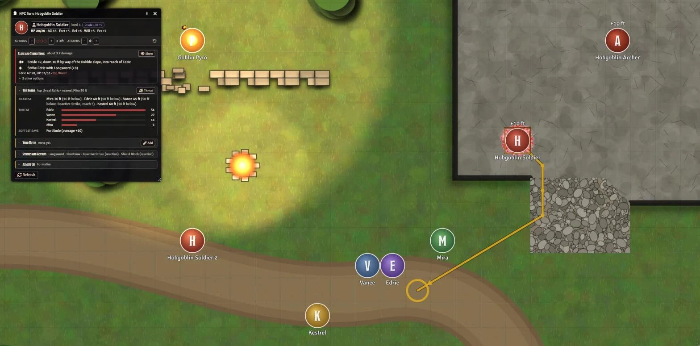
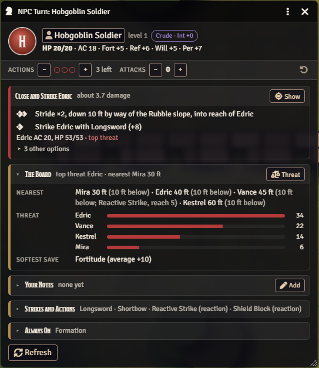
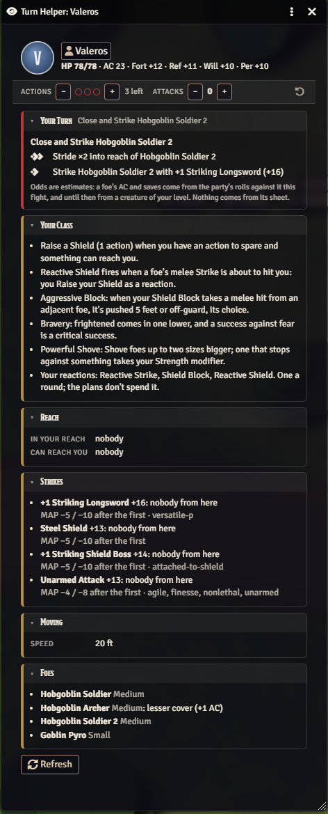
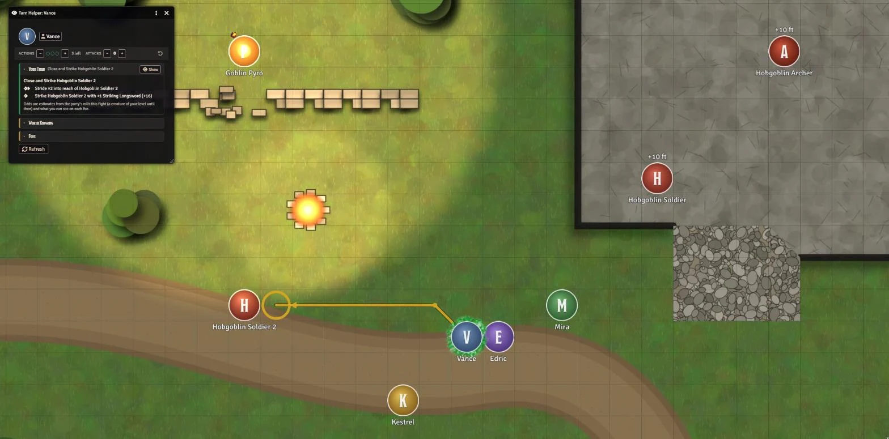
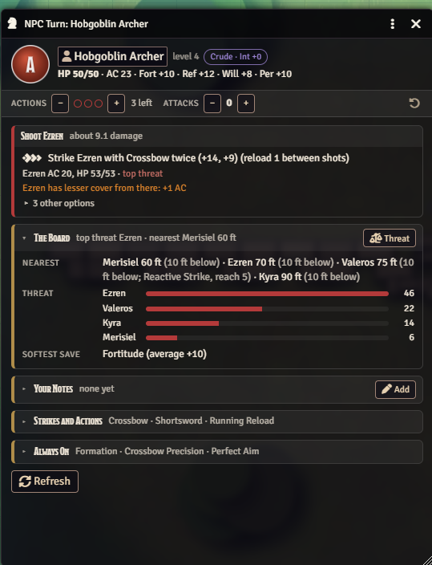
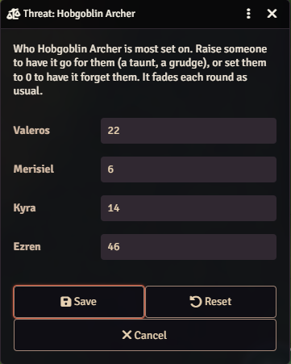

# PF2e Tactics

PF2e Tactics: an NPC turn card for the GM, and a Turn Helper for players. When an NPC's turn starts it shows a recommended turn worked out from the creature's abilities and the board (who it can reach, flanking, reactions it would provoke, expected damage, who it would pick given its wits and who has hurt it), a few alternatives, the encounter's own tactics, triggers to watch for, and every Strike, action, reaction and spell it has. Nothing is moved or rolled for you. The Turn Helper (a macro, or a per-player setting to open it on their turn) gives a player a recommended turn for their own character, with their class read in (Commander tactics, Spellstrike, Exploit Vulnerability...), on what the party can judge of each foe: reach, Strikes and targets, flanking, cover, what moving would provoke, and what the party's own rolls have learned. Nothing from an NPC's sheet.

## What it looks like



It's the hobgoblin's turn on the ledge. The card suggests two Strides down the rubble slope to reach Edric, the one it's most set on, then a Strike, and **Show** draws that path on the map so you can check it at a glance. The Board says who is nearest (and who is 10 feet below), who could hit it with a Reactive Strike, and which save the party is weakest in.

<table>
<tr>
<td width="50%" valign="top"></td>
<td width="50%" valign="top"></td>
</tr>
<tr>
<td valign="top"><b>NPC turn card.</b> A suggested turn with a damage estimate, a few other options, the board, your own notes for the creature, and every Strike and action it has. Nothing is moved or rolled for you.</td>
<td valign="top"><b>Turn Helper</b> for players. A suggested turn for their own character, with the class notes that bear on it, what's around them and what the party has learned about each foe folded underneath. Nothing comes from an NPC's sheet.</td>
</tr>
</table>



On Vance's turn the Turn Helper suggests two Strides along the road to the nearer hobgoblin, then a Strike. **Show** draws the route on that player's map only, and it goes round only the reactions the party has seen.

Threat works like aggro. Each creature remembers who has been a problem for it (damage, spells and saves, healing its foes), and when two targets are close it goes for the one who has proven dangerous. Here the archer shoots Edric, its top threat, though Mira is nearer. More in [Threat](docs/gm-guide.md#threat).

<table>
<tr>
<td width="60%" valign="top"></td>
<td width="40%" valign="top"></td>
</tr>
<tr>
<td valign="top"><b>The Board</b> shows the creature's threat table as bars. It fades each round, and drops when someone falls unconscious.</td>
<td valign="top"><b>Threat</b> sets it by hand: raise someone for a taunt or a grudge, set someone to 0 to have it forget them, or Reset.</td>
</tr>
</table>

## Install

In Foundry, go to **Add-on Modules**, then **Install Module**, and paste this into **Manifest URL**:

```
https://github.com/Sir-Bayard/pf2e-tactics/releases/latest/download/module.json
```

Foundry's **Update** button then picks up each new release. You can also download `module.zip` from the [latest release](https://github.com/Sir-Bayard/pf2e-tactics/releases/latest) and unzip it into `Data/modules/pf2e-tactics`.

Requires Foundry VTT 14 (verified on 14.370) and the Pathfinder 2e system 8.0.0 or later, in English: the module reads the wording of abilities and chat cards, so with a translated system much of the advice goes quiet.

## What it does

When an NPC's turn starts, a window shows the GM how that creature can fight well right now:

- A recommended turn, worked out from its abilities and the board: who it can reach and with how many actions, flanking with its allies, which player reactions (Reactive Strike and the like) a move would provoke, and the expected damage of each option against each target's AC and saves.
- Two or three alternatives, so you can pick something else in a second.
- Show draws the recommended path on your map, around any reactions it avoids. Only you see it: it's drawn in your client, not saved to the scene. Click Show again to hide it; it also clears on the next turn.
- [Triggers](docs/gm-guide.md#triggers) to watch for, and the encounter's own tactics.
- Every Strike, action, reaction, free action, aura and spell it has, so nothing gets forgotten.
- **The turn so far**: actions used and attacks made, so the advice after a Stride or a Strike is for the actions it has left, at the right multiple attack penalty ([more](docs/gm-guide.md#the-turn-so-far)).

## Guides

- [The GM's guide](docs/gm-guide.md): the card, settings, how it reads abilities and the board, how clever each creature is, [threat](docs/gm-guide.md#threat), the rules it follows, what it doesn't know, triggers, your notes, What the Party Knows and the API for other modules.
- [The Turn Helper](docs/turn-helper.md): the players' window, how it [estimates](docs/turn-helper.md#estimates) a foe it can't see the sheet of, and what it plans for each class.

## Changes

See [CHANGELOG.md](CHANGELOG.md).

## How it was made

This module was written with Claude, Anthropic's AI assistant, directed and tested by its author at a real table. It is shared as is, for free.

## Problems and suggestions

Open an [issue](https://github.com/Sir-Bayard/pf2e-tactics/issues).

## License

[MIT](LICENSE). Copyright (c) 2026 Sir Bayard.

## Pathfinder

PF2e Tactics is an unofficial, free module for the Pathfinder Second Edition system on Foundry VTT. It is not published, endorsed or specifically approved by Paizo Inc. Pathfinder is a trademark of Paizo Inc., used here only to say which game the module works with. The module follows the game's rules, which Paizo publishes under the ORC License, and refers to them by name; it doesn't reproduce Paizo's rules text, art or setting material.
